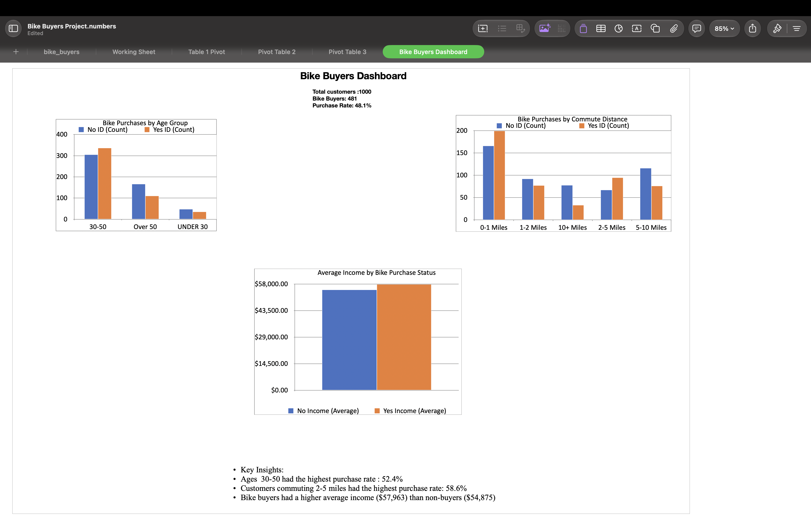

# Bike Buyers Analysis

## Project Overview
Analyzed bike purchase patterns among 1,000 customers to explore how age, income, and commute distance relate to purchasing behavior.

## Tool Used
Apple Numbers

## Data Preparation
- Removed 26 duplicate records, leaving 1,000 unique customers.
- Converted marital status and gender abbreviations into readable labels.
- Checked for missing values and reviewed age and income ranges.
- Created age groups for comparison.

## Analysis
Created pivot tables and charts to compare:
- Bike purchases across age groups
- Bike purchases by commute distance
- Average income of buyers and non-buyers

## Key Findings
- 481 of 1,000 customers purchased a bike: a 48.1% purchase rate.
- Customers aged 30–50 had the highest purchase rate among age groups: 52.4%.
- Customers commuting 2–5 miles had the highest purchase rate among commute groups: 58.6%.
- Buyers had a higher average income ($57,963) than non-buyers ($54,875).

## Dashboard
Created a dashboard with summary metrics, three charts, and key insights.

## Skills Demonstrated
Data cleaning, formulas, pivot tables, data visualization, and communicating insights.

## Limitations
These findings describe patterns in this dataset and do not establish what caused customers to purchase a bike.

## Additional Analysis: Purchase Rate by Gender

| Gender | Buyers | Total Customers | Purchase Rate |
|---|---:|---:|---:|
| Female | 239 | 489 | 48.9% |
| Male | 242 | 511 | 47.4% |

Although male buyers slightly outnumbered female buyers, the female purchase rate was slightly higher. The difference was approximately 1.5 percentage points, indicating similar purchase rates across both groups in this dataset.
